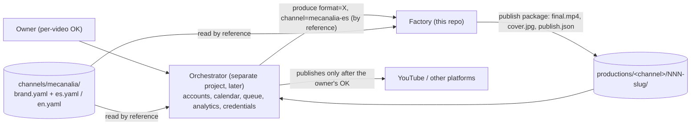

# Architecture and repository organization

Written 2026-10-31 with the `architecture-designer` skill (user level, `~/.claude/skills/`). The model in Part A is the owner's; this file records it, the
mechanisms that implement it, and every deviation. Part B is the repository organization convention (also stated in the standing doctrine, CLAUDE.md "Repository organization"
with its home `docs/current/specs/doctrine-pipeline.md` since 2026-11-11, which wins on conflict only for rules it states explicitly).

## Part A: the model

### Governing principle
A channel's identity lives in ONE source of truth, owned by no consumer. The factory and the future orchestrator READ it by reference; neither copies its values.
(The one deliberate exception is the per-production snapshot: each `scenes.json` embeds a verbatim copy of the blocks it used, so a finished production stays
reproducible after the brand changes. That is a record, never a second source.)

### Requirements summary
- Functional: produce faceless Shorts in several languages under one brand; the orchestrator (separate project, later) requests production by reference.
- Non-functional: public and versioned packages (so no secrets), reproducible productions, owner gate on every publication, free-tier tooling, one engine per video.
- Constraints: the factory never holds platform credentials; nothing publishes without the owner's explicit per-video OK; cadence is the orchestrator's design, not this document's.

### Three independent axes
1. **FORMAT**: how a video is made. A format is a module inside the factory sharing the core (`factory/`: schema, editor, identity, gate, driver). Today there is one
   format, `explainer-short` (declared in `channels/mecanalia/brand.yaml` `formats`); it IS the current factory. A second format becomes
   `factory/formats/<name>/` when it exists; nothing is pre-built for it (see ADR-5).
2. **CHANNEL**: brand + language + accounts, as data packages (`channels/`).
3. **ENGINE**: code3d vs fal.ai, decided per video, never mixed within a video (unchanged: CLAUDE.md "Engine selection").

Default rule: one channel, one format. An exception is made only by the owner's explicit instruction for a specific video and never silently becomes the default.

### Brand and channel packages (inheritance)
```
channels/
  mecanalia/
    brand.yaml        BRAND package: language-independent (identity/palette, style string, subtitles, render and audio profiles, duration bands, topic mix, formats, assets)
    es.yaml           CHANNEL mecanalia-es: language es, @mecanalia, voice, bio, description template, hashtags, words_per_second
    en.yaml           CHANNEL mecanalia-en: language en, @mecanaliaen (fallbacks mecanalia_en, mecanalia.en), voice, bio, templates
    assets/fonts/     shared brand assets (Montserrat, SIL OFL)
```
- A channel variant `extends: mecanalia` and stores only what differs. A channel value wins; a missing value inherits the brand's. Merge: dicts merge key by key,
  lists and scalars are replaced whole (`factory/channel.py`, `deep_merge`). `tests/test_channel.py` enforces that a variant holds only the allowed
  difference keys (language, register, promise, handles, voice, duration.words_per_second, publish) and never forks the identity.
- Today's `channels/umbrella-es.yaml` became `brand.yaml` (everything language-independent) plus `es.yaml` (voice, language, register, promise, words_per_second).
  The merged `mecanalia-es` config was verified equal to the old file block by block (identity, render, style, subtitles, visual_identity, audio, duration, voice,
  topic mix), so no production or gate record changed because of the split.
- Language is configuration: `es.yaml` and `en.yaml` differ in values, not in code. English is configuration only; no English production exists and its
  `words_per_second` is `null` until measured on the first English narration.
- **No credentials in packages.** Platform tokens live only in the orchestrator's credential store. `tests/test_channel.py` fails if a package contains
  words such as token, secret, password, api_key.

### Flows and contracts

- **Request:** the orchestrator asks for `format=<name>, channel=<channel-id>` (`factory.channel.load(<id>)` resolves it); it never copies palette, voice or texts.
- **Factory -> orchestrator contract (the publish package):** in the production folder `productions/<channel>/<NNN-slug>/`: `final.mp4`, `cover.jpg` and
  `publish.json` `{channel, title, description, music_credit, hashtags, video, cover}`. `tools/publish_package.py build|check` writes and validates it;
  `music_credit` is copied from `scenes.json audio.music_credit` and must reach the platform description if a credited track is ever approved (today it is null everywhere: productions ship without music, owner 2026-11-01). Productions 004 to 007 have one; 001 to 003 predate
  it (see "Left for the owner"). Asset credits (CC-BY) are never part of the description (owner 2026-11-07); `check` rejects them.
- **Hashtag policy (marketing lead, 2026-11-01; rule in `brand.yaml publish.hashtags`, tags in each variant's `publish.hashtags`, enforced by `publish_package.py check`):**
  3-5 hashtags per video (the count varies), in the description, never the title. Slot order: 1-3 TOPICAL tags first (the object, then the phenomenon: what a viewer
  searches; YouTube shows only the first three above the title), then ONE family tag fixed per `topic_family` (es: objects #comofunciona, body #cuerpohumano, numbers
  #curiosidades, whatif #quepasaria), then the fixed base LAST (`#shorts` only). Why: a big fixed base repeated on every video (the old `#shorts #ciencia #curiosidades
  #comoFunciona`, and the de-facto `#cienciaencasa #sabiasque`) spends the few visible slots on generic words and dilutes the topical signal; a base of one plus a family
  tag gives series grouping at no cost. Pan-Hispanic synonyms are welcome as topical tags (#palta #aguacate). `hashtags_base` is retired.
- **Search and packaging policy (marketing lead, 2026-11-08; FORWARD-ONLY: applies to productions packaged after this date, published videos and packages are never edited; the owner delegated it to the lenses).**
  1. *Title formula:* the title mirrors the question a viewer actually types. Approved question form per the hook formula (`¿Por qué…?`, `¿Qué pasa si…?` / `¿Qué pasaría si…?`, `¿Cuántos…?`), the everyday OBJECT or mechanism word within the first words (search weights the front, and the Shorts feed truncates), pan-Hispanic vocabulary (a synonym goes in the hashtags or description, never a local word in the title), about 60 characters at most, exactly one trailing emoji, no hashtags. The title may differ from the spoken hook when that makes it closer to the typed query.
  2. *Description template:* line 1 restates the question in searchable words and summarises the answer in one clause (it is the search snippet and the only line shown before "más"); line 2 is the twist (the mini-hook); then the share line naming the archetype; no asset credits (owner 2026-11-07), no sources lines. Hashtags: the standing policy above, unchanged (3-5, topical first, family tag, `#shorts` last).
  3. *One public playlist, "Empieza aquí" (owner correction 2026-11-08; supersedes the four family playlists first set the same day):* the channel is ONE channel with ONE promise, so its public surface has exactly one playlist. Contents rule: the channel's published videos, strongest performers first, as measured by the channel's analytics (re-ordered by the owner on the platform as the numbers change). The four topic families (objects, body, numbers, what-if) are an internal production taxonomy that governs topic selection and balance; they are never public channel structure, and no per-family playlist exists. The name lives in `channels/mecanalia/es.yaml publish.playlists`; the English variant defines its own later. Nothing in the repo creates a playlist.
  4. *No enforcement code yet:* the rules are checked by the marketing lens at the package stage; a `publish_package.py check` rule would also fail the published 001-011 packages, so it waits for a decision on scope.
- **Cadence (marketing lead, 2026-11-03):** 1 video per day per automated platform, test kept pure to 2026-11-30; conditions to revisit in `docs/current/reports/cadence-decision.md`.
- **The factory never holds platform credentials** and never publishes.
- **Invariant:** nothing publishes without the owner's explicit per-video OK. The cadence around that gate belongs to the orchestrator's design.

### Multi-lens protocol (one lead per stage; no artefact is approved by a single lens)
| stage | lead | consulted | note |
|---|---|---|---|
| topic | marketing (`yt-seo`, `youtube-shorts`, `social-seo`, `thumbnail-design`, `hook-writer`) | scriptwriter | criterion: maximise expected views on recorded evidence (family proportions are an outcome, never a quota); every proposal passes the curiosity test and the one-line hook test, and a slate stays balanced across tensions and themes (CLAUDE.md "Topic selection", owner 2026-11-07); a modellability failure gets one reshape attempt before rejection (CLAUDE.md "Reshape ladder"); topics are supplied through the standing pool `docs/current/idea-bank.md` (CLAUDE.md "Idea bank"): an Opus session fills it, production sessions only draw from it; design vetoes only on feasibility |
| script | scriptwriter (`yt-script`, `short-form-video-script`, `hook-writer`) | marketing, design | |
| scene design | design (`tastemaker`, `design-taste-frontend`, and the asset-job skills of the Skill role map) | scriptwriter, marketing | composition gate is the mechanical check |
| publish package | marketing | | texts come from the channel package (`publish` block) |
The lenses are the skill packs installed at user level (`~/.claude/skills/`); this repository contains no skills, and only the skills in CLAUDE.md "Project skills" are used.
Since 2026-11-04 the lenses hold standing authority over creative and technical matters when all involved lenses approve and the decision is logged (CLAUDE.md "Governance"; `docs/current/reports/lens-decisions.md`). Spending, publishing, creating accounts and the final publish/reject verdict stay with the owner.

### Decisions (ADR summary)
| # | decision | alternatives | trade-off |
|---|---|---|---|
| 1 | Brand package + thin channel variants with a deep-merge loader | one file per channel (copy), or code-level subclassing | no duplicated identity, one edit switches every channel; cost: a loader and a test keep variants thin |
| 2 | Variants limited to an allow-list of keys (tested) | free-form overrides | stops silent forks of the identity; adding a new override key means editing the test on purpose |
| 3 | Per-production snapshot of identity blocks stays | pure by-reference | reproducibility of finished videos beats purity; the snapshot is a record |
| 4 | Publish package as `publish.json` + files in the production folder | a separate `publish/` folder; database | zero new infrastructure, versioned text, orchestrator reads a known path |
| 5 | Format modules are a convention, not built | build `factory/formats/` now | one format exists; pre-building is the over-engineering the skill warns about; the first second format creates the module |
| 6 | Credentials excluded by rule and test | encrypted secrets in the repo | the repo is public; the orchestrator owns secrets |

Risks and mitigations: a channel variant drifting from the brand (allow-list test); a stale or secret-bearing package committed (credential test); the orchestrator
copying values (contract says by reference; `factory/channel.py` is the single reader); numbering collisions (the scaffold tool and the layout test).

## Part B: repository organization (the convention)

### Problems solved
Some 40 folders flat in `productions/pilot/`, some 25 documents flat in `docs/`, no ordering to spot the newest video, and everything under "pilot" although the pilot is over.

### productions/
```
productions/
  README.md
  mecanalia-es/            CURRENT videos, one tree per channel
    INDEX.md               number, slug, family, status, date
    001-huincha-de-medir-coral/ ... 005-inodoro-donde-va-todo/ (006-011: the 2026-11-03 batch, REJECTED by the owner 2026-11-04, likeness failure, do not publish; the original 006/007 are archived)
  mecanalia-en/            (empty: INDEX.md only)
  _lab/                    experiments and tests, grouped by kind
  _archive/                superseded and frozen productions, grouped by series
```
- Per-channel trees; the pilot folder is gone. `_lab` and `_archive` start with an underscore so they sort apart from the channels.
- **Numbering:** `NNN-slug`, three digits, per channel, in order of creation; the highest number is the newest; numbers are never reused (an archived numbered
  production keeps its number). `tools/new_production.py <channel-id> <slug>` assigns the next number and appends a row to the channel's `INDEX.md`.
  Slugs: lowercase ascii words joined by `-`.
- **Current vs lab vs archive:** current = candidates under the active identity; `_lab` = tests, benches, spikes, validations (never published); `_archive` =
  superseded versions and frozen records of retired identities (moved with `git mv`, never deleted).

### docs/
```
docs/
  README.md  architecture.md
  current/{specs,reports,research}/    in force: binding specs and rubrics; evidence behind adopted decisions; external research
  experiments/                         rounds, proposals and tests that informed decisions (+ runs/ for dated run logs)
  archive/                             superseded documents kept verbatim
```
Evidence folders live next to the document that cites them (`design-system-assets/` with `design-system.md`, `render-bench/` with `render-bench.md`, ...).

### Map of what moved
| old (`productions/pilot/...`) | new |
|---|---|
| huincha-de-medir-coral, engranajes-coral, reloj-coral | `productions/mecanalia-es/001-huincha-de-medir-coral`, `002-engranajes-coral`, `003-reloj-coral` |
| imanes, inodoro-donde-va-todo | `mecanalia-es/004-imanes`, `005-inodoro-donde-va-todo` |
| por-que-no-nos-gusta-lo-mismo, por-que-cuesta-dejar-el-alcohol | `_archive/retired-006-007-2026-11-03/` (archived 2026-11-03 by owner instruction before publication; numbers 006-011 reassigned to the new batch) |
| puntos-de-sutura, -v2, -v3, -v4-code3d, -v4-code3d-cartoon, -v4-code3d-toon, -v5-drawn, -v6-staged, -v7-cutaway, -v7-drawn, -v7-fal | `productions/_archive/puntos-de-sutura/<same name>` |
| huincha-de-medir | `_archive/dark-reference-look/huincha-de-medir` |
| huincha-de-medir-papel, engranajes-papel | `_archive/papel-identity/<same name>` |
| looktest-A/B/C, looktest-sheets, identity2, identity2-sheets | `_lab/look-tests/<same name>` |
| ds-validate, dr2-validate, coral-verify, finalist-motion | `_lab/identity-validation/<same name>` |
| engine-spike | `_lab/engine-spike` |
| spikes/{cartoon-concepts-scene2, cartoon-model-scene2, lace-world-scenes} | `_lab/spikes/<same name>` |
| closing-test (local only) | `_lab/closing-test` |

| old (`docs/...`) | new |
|---|---|
| design-system.md, design-system-assets/ | `docs/current/specs/` |
| reference-format-spec.md, reference-style-spec.md, style-rubric.md | `docs/current/specs/` |
| marketing-verdicts.md, cta-redesign/, cta-endcard-audit.md, render-bench.md, render-bench/, render-profile-rider.md | `docs/current/reports/` |
| reference-channels.md, names-general.md, reference/ (media) | `docs/current/research/` |
| design-round2.md + design-round2/, colour-panel.md, hard-constraints.md, marketing-review/, motion-finalists/, overnight-2026-10-28.md | `docs/experiments/` (the overnight log in `experiments/runs/`) |
| design-system-round1-superseded.md, design-system-proposal/, design-system-proposed.diff | `docs/archive/` |
| `channels/umbrella-es.yaml` | `channels/mecanalia/brand.yaml` (+ new `es.yaml`, `en.yaml`) |
| `factory/assets/fonts/` | `channels/mecanalia/assets/fonts/` (brand-owned shared asset) |

All moves were done with `git mv` (or a plain `mv` for local-only gitignored folders); nothing was deleted. Path citations inside docs, notes, reports and
tools were rewritten mechanically; `channels/umbrella-es.yaml` mentions inside `docs/archive/design-system-proposal/` and the archived diff were left
as the historical record they are.

## Deviations from the model, and why
1. **Fonts moved into the brand package** and `factory/overlays.py`, `tools/brand_mark.py` point to it: the model says shared assets belong to the brand. The brand mark stays
   generated by `tools/brand_mark.py` from the identity preset (the package references the tool rather than storing a second copy).
2. **Per-production snapshot of identity blocks** (governing principle exception, ADR-3).
3. **Format modules not built** (ADR-5): only the declaration (`formats` in `brand.yaml`) and the convention (`factory/formats/<name>/`).
4. **Comments in `code3d/lib/{looks,pipeline_config,tape_rig}.py` still cite `channels/umbrella-es.yaml`.** These files are in the composition-gate fingerprint
   (`factory/gate.py`); editing even a comment would make every production's gate record stale and force GPU re-runs. They are fixed with the next real edit of those files.
5. **Merge semantics refined:** the model says "a channel value wins, a missing value inherits"; lists and scalars are replaced whole, dicts merge (an explicit `null`
   counts as set, e.g. English `words_per_second`).
6. **`.tastemaker/style-lock.md` stays at the repo root** (a style lock is a doctrine file, allowed in this repo); only its docs link was updated.
7. **Naming:** channel ids are `mecanalia-es` / `mecanalia-en` (file `channels/mecanalia/<lang>.yaml`); `umbrella-es` survives only in historical documents.
8. **Handles are intended, not verified:** creating or checking accounts is the owner's / the orchestrator's job; the repo records `@mecanalia`, `@mecanaliaen` and the fallbacks only.
9. **English voice** `en-US-AndrewNeural` is a provisional starting value (it exists in edge-tts; not auditioned).

## Asset library (added 2026-11-04)
`assets/registry.yaml` lists the free sources; `assets/library/<slug>/` stores every hero object (records committed, binaries local). Tool: `factory/asset_library.py`. Manual: `docs/current/specs/asset-system.md`.

## Left for the owner
- Gate records of `001` to `003` (tape, gears, clock) were already stale before this reorganization (a later change to shared rigs or identity); `004` to `007` pass. Re-run
  `.venv/bin/python factory/gate.py run productions/mecanalia-es/<NNN-slug>` before any re-render of those three.
- `001` to `003` now carry a "Publish package" notes section and a `publish.json` (2026-11-01; 001 and 002 descriptions drafted from their narration, pending owner review; 003 uses its caption_draft).
- `code3d/lib/` still mixes live rigs with retired ones (`cartoon.py`, `toon.py`, `lace_world.py`, `body.py`, `suture.py`, `boot_world.py`, `dark_rig.py`, ...); moving them would change gate
  fingerprints, so it is left as a separate decision. `spikes/` at the repo root and `code3d/scenes/` (one prefix per production family) were not reorganized: out of this run's scope.
- Whether `mecanalia-en` gets a voice other than the provisional one, and when its first production starts.
- The orchestrator's design (accounts, calendar, queue, analytics, credential store, cadence around the per-video OK) is not specified here by instruction.
